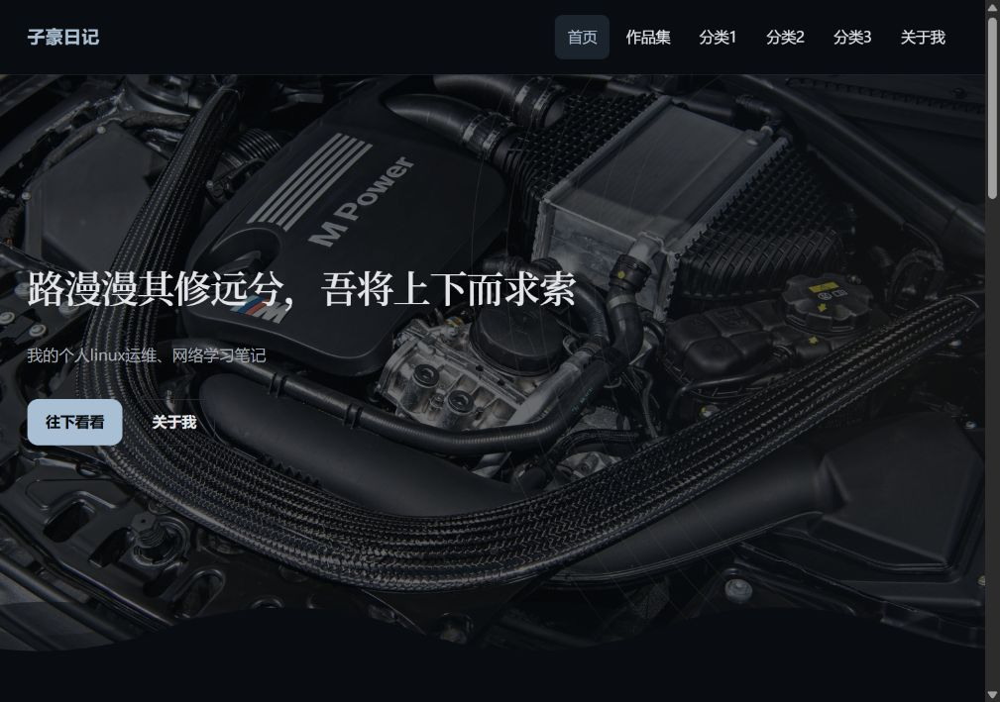
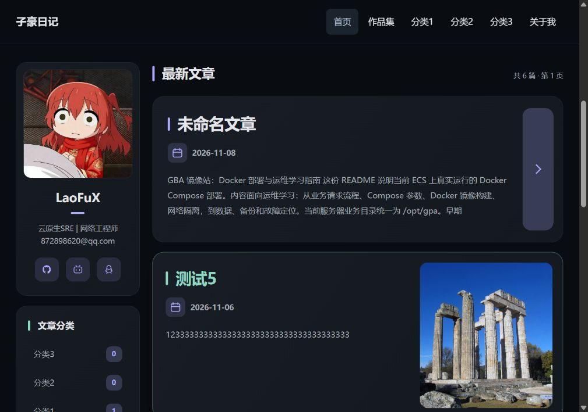
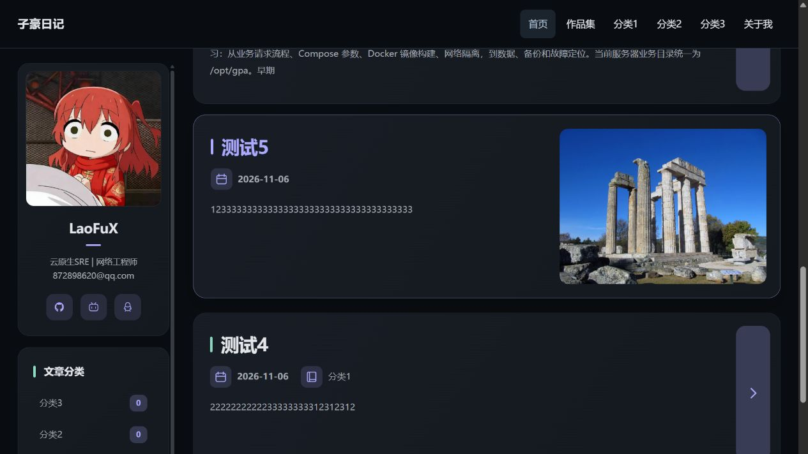
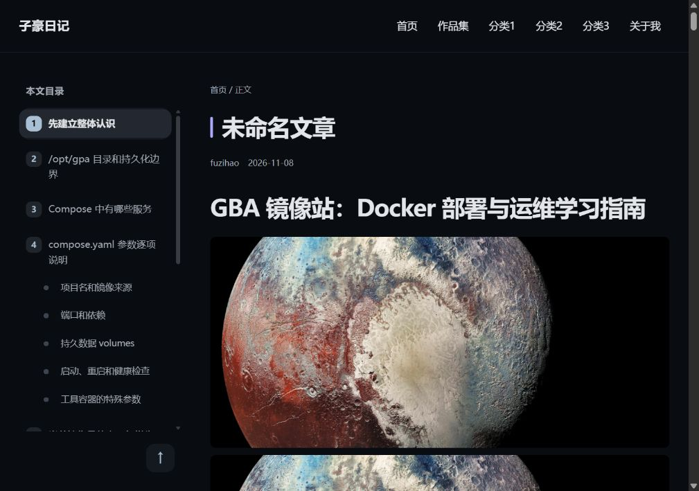
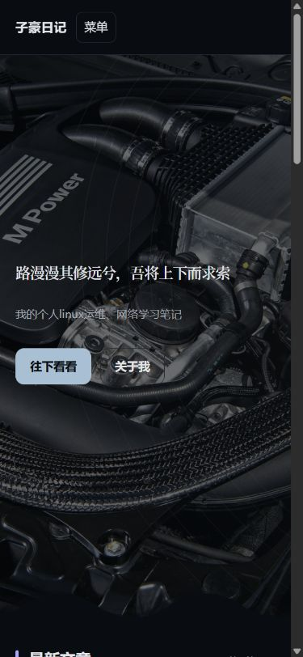
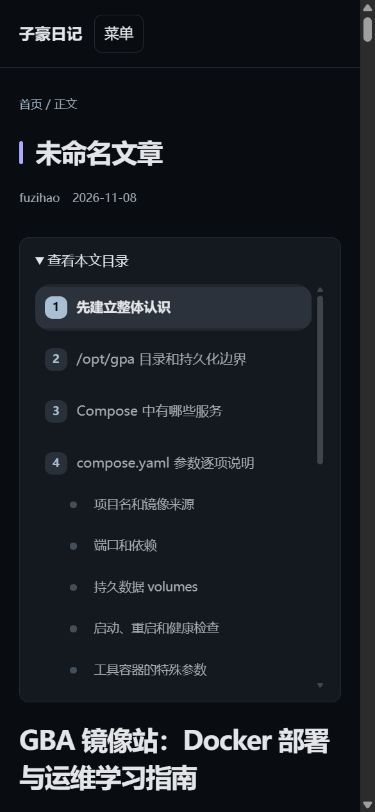

# 子豪日记 · Halo 主题

面向个人日记、技术笔记与作品记录的 Halo 2.x 主题。采用深色卡片、宽幅首页首屏、文章目录和响应式布局，外观在 Halo 中文后台维护。

**当前版本：1.2.7** · **Halo 要求：>= 2.27.2** · **许可证：MIT**

演示站点：[fuzihao.me](https://fuzihao.me/)。截图展示演示站点的自定义配置；首次安装使用主题默认值，文章、头像、背景图与菜单需要自行配置。

## 导航

- [主题预览](#主题预览)
- [功能与版本信息](#功能与版本信息)
- [安装与升级](#安装与升级)
- [外观配置](#外观配置)
- [开发与构建](#开发与构建)
- [源码结构](#源码结构)
- [发布到 GitHub](#发布到-github)
- [兼容性与已知边界](#兼容性与已知边界)
- [更新记录](CHANGELOG.md)

## 主题预览

### 首页首屏

宽幅背景、单行诗句、说明文字与行动按钮；支持自定义图片、按访问轮换背景和底部波浪。未配置图片时使用主题自带的原创 SVG 背景。



### 文章列表与辅助栏

文章卡片整张可点击；有封面时展示大图，无封面时使用文字卡片与侧边箭头。辅助栏可配置个人资料、分类、推荐链接和运行时间。桌面端滚动时整组辅助栏吸附在顶部导航下方；超过屏幕高度时可在栏内滚动。



1.2.7 新增吸顶效果（页面已向下滚动）：



### 文章阅读与章节目录

桌面目录支持章节高亮，正文支持代码块、表格和宽内容横向滚动；底部展示上下篇导航。目录由正文标题生成，没有目录时不占用侧栏。



### 手机端

手机端收起顶部导航，文章目录改为可展开区域，列表与正文按可用宽度排版。

<p>
  
  
</p>

吸顶截图为 1.2.7，其他截图沿用此前版本的前台实拍，不包含后台账户或服务器管理界面。演示文章、头像与第三方背景图仅在截图中展示，不额外分发原始媒体文件；自己的站点请配置有权使用的内容。

## 功能与版本信息

| 项目 | 说明 |
| --- | --- |
| 显示名称 | 子豪日记 |
| 主题 ID | `theme-hao-diary` |
| 当前版本 | `1.2.7` |
| Halo 版本声明 | `>=2.27.2`，已在 2.27.2 验证 |
| Setting 名称 | `theme-hao-diary-setting` |
| ConfigMap 名称 | `theme-hao-diary-configmap` |
| 构建环境 | Node.js `>=22.12.0`；pnpm `10.28.2` |
| 构建方式 | Astro 生成 Thymeleaf 模板，Halo `theme-package` 打包 |
| 页面范围 | 首页、文章、独立页面、分类、标签、作者、归档、404 |
| 外观配置 | 中文后台设置；可选访客深浅色切换 |
| 上游基础 | Fuwari `v2.2.0` 的构建链与模板接口 |

主要功能：

- 首页背景轮换、波浪、可关闭的加载动画与分层入场。
- 有封面/无封面文章卡片、分类切换和分页。
- 桌面章节目录、手机折叠目录及上下篇文章导航。
- 文章进入与返回的轻量淡入上移效果，保留完整页面导航和插件初始化。
- 尊重系统“减少动态效果”；站内返回首页不重播全屏加载动画。
- 1.2.7 文章过渡最多处理 8 个可见元素，总面积不超过两个视口；滚轮、触屏、指针或键盘输入会取消当前过渡。

图片灯箱、代码高亮和编辑器渲染由相应 Halo 插件提供，主题不捆绑这些插件。`gallery-controls.js` 提供对已有 PluginLightGallery 1.x 的适配。

## 安装与升级

1. 打开本仓库 **Releases**，选择 `v1.2.7`。
2. 下载附件 **`theme-hao-diary-1.2.7.zip`**。
3. 登录 Halo 控制台，打开“外观 → 主题 → 主题管理 → 上传安装 / 升级”。
4. 上传 ZIP；已有同 ID 主题时确认升级，首次安装后启用“子豪日记”。
5. 配置菜单、首屏、资料卡和页脚，打开前台检查。

GitHub 自动生成的 **Source code (zip/tar.gz)** 是源码，不可直接作为主题安装包。没有 Release 时，请先按下文构建。

升级前保存旧主题包和自己的配置记录。升级通常沿用同 ID 的配置，但仍应核对字段与前台效果；主题升级不能代替文章、附件和数据库备份。

### 本次整理附带的现成安装包

```text
release-assets/theme-hao-diary-1.2.7.zip
release-assets/SHA256SUMS.txt
```

这个 ZIP 是已上线版本的原始安装包。`release-assets/` 被 Git 忽略，不进入源码提交；发布时将 ZIP 手动上传为 Release 附件。GitHub 克隆不会自动获得这个本地目录，请从 Releases 下载。

## 外观配置

| 内容 | Halo 操作入口 |
| --- | --- |
| 站点名称、站点图标 | 系统 → 设置 → 基本设置 |
| 顶部导航名称和链接 | 外观 → 菜单；主题“基础信息”中选择菜单 |
| 诗句、说明、按钮、背景、波浪 | 主题设置 → 首页首屏 |
| 深色背景、卡片、文字、细节色 | 主题设置 → 配色 |
| 卡片高度、封面占比、标签 | 主题设置 → 文章列表 |
| 正文字号、行高、目录层级 | 主题设置 → 字体与阅读 |
| 首页入场、加载动画和时长 | 主题设置 → 动效 |
| 头像、简介、社交链接、模块顺序 | 主题设置 → 辅助栏 |
| 页脚文案、版权、备案与署名 | 主题设置 → 页脚 |

主题不自动创建演示文章、分类或“关于我”页面。默认按钮中的 `/about-me` 等地址应对应到实际页面。`默认设置.json` 是默认值参考，不是生产站点配置，不要直接覆盖自己的设置。

详见 [安装与日常使用指南](docs/使用指南.md)。

## 开发与构建

在仓库根目录执行：

```powershell
node --version
npx --yes pnpm@10.28.2 install --frozen-lockfile
npx --yes pnpm@10.28.2 run build
```

输出：

```text
templates/                          # 生成的 Halo 模板和资源
dist/theme-hao-diary-1.2.7.zip        # 可安装主题包
```

`templates/`、`dist/`、`node_modules/` 为本地生成内容，不提交。保留 `pnpm-lock.yaml`。不要手改 `templates/`；页面修改 `src/`，样式和交互修改 `public/assets/`。

这是 Halo 服务端主题，Astro 在这里负责模板构建。直接打开源码 HTML、普通静态预览或 GitHub Pages 不能替代 Halo 的真实渲染。请安装构建包到 Halo 测试实例验收页面和插件。

`npx --yes pnpm@10.28.2 run dev` 用于监听并重新构建模板，不会启动 Halo 或自动更新生产站点。完整说明见 [开发维护指南](docs/开发维护指南.md)。

## 源码结构

```text
src/
  pages/                    页面构建入口
  layouts/Shell.ts          HTML 框架和资源版本
  components/               首屏、列表、目录、导航和页脚
public/assets/
  diary.css                 基础布局与阅读样式
  refinement.css            卡片、目录和装饰样式
  diary.js                  阅读交互、目录和首屏初始化
  settings.js               配置读取与加载动画策略
  hero-background.js        首屏背景轮换与恢复
  page-transitions.js       文章进入与返回的轻量过渡
  listing-navigation.js     分类/分页导航和滚动位置
  gallery-controls.js       已安装图片灯箱的交互适配
ui-plugin/                  上游工作区参考，当前页面不加载
i18n/                       保留的国际化资源
docs/                       操作指南、来源记录和前台截图
theme.yaml                  Halo 主题元数据
settings.yaml               后台设置定义
默认设置.json               默认值参考
pnpm-lock.yaml              固定依赖解析结果
```

`ui-plugin/` 仍在 `pnpm-workspace.yaml` 中，保留其源码和依赖声明以保持锁文件构建结构完整；它不表示定制主题启用了上游编辑器 UI。

## 发布到 GitHub

采用 **main 分支存源码 + Git 标签标记版本 + Releases 提供安装包**：

1. 创建空仓库 `theme-hao-diary`，不自动创建 README、许可证或 `.gitignore`。
2. 在本目录运行 `git init`、`git branch -M main`、`git add .`，检查暂存清单。
3. 提交源码，添加自己的远程地址并推送。
4. 创建 Release，标签填 `v1.2.7`，目标选择本次版本提交。
5. 上传主题 ZIP，粘贴 [1.2.7 发布说明](docs/RELEASE-v1.2.7.md)，然后发布。

新版本源码使用 `git add`、`git commit` 和 `git push` 提交；在 Releases 选择对应源码提交并创建版本标签，上传安装包。不要上传服务器配置、数据库、密钥和个人后台设置。

本目录未启用上游应用市场自动发布流程，不会自动向上游应用 ID 发布，也不要求提供 `HALO_PAT`。

## 兼容性与已知边界

- 当前实际验证基于 Halo 2.27.2；更高 Halo/插件版本仍需回归检查。
- 当前不提供 `templates/layout.html` 布局契约，依赖它的页面工坊或插件页面可能使用 Halo fallback 布局。
- 不保证兼容原版 Fuwari 的全部功能；文章使用完整页面导航保留插件初始化。
- 系统减少动效、后台关闭动效，或过渡期间输入导致动画关闭/中止，均为正常行为。
- 1.2.7 保留 1.2.4 的滚动性能修复；现有验证为特定环境采样，不代表所有设备、网络和插件组合都不会卡顿。
- 代码高亮、灯箱与图表效果还受编辑器和插件影响；截图不是插件安装清单。

## 来源与许可证

基于 [jiewenhuang/halo-theme-fuwari](https://github.com/jiewenhuang/halo-theme-fuwari) 的 **v2.2.0 正式版**构建链、依赖锁文件与 Halo 数据接口定制。独立主题 ID 为 `theme-hao-diary`。上游标签及文件哈希见 [docs/上游来源.json](docs/上游来源.json)。

使用 [MIT License](LICENSE)，保留 saicaca、Jevon 的原版权声明。截图中的第三方媒体和演示文章不因主题代码采用 MIT 自动获得相同授权。
