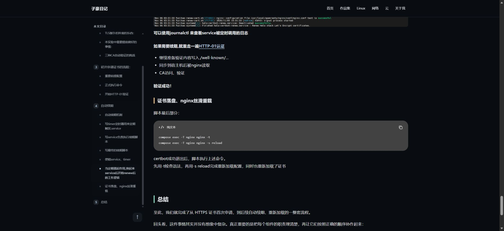
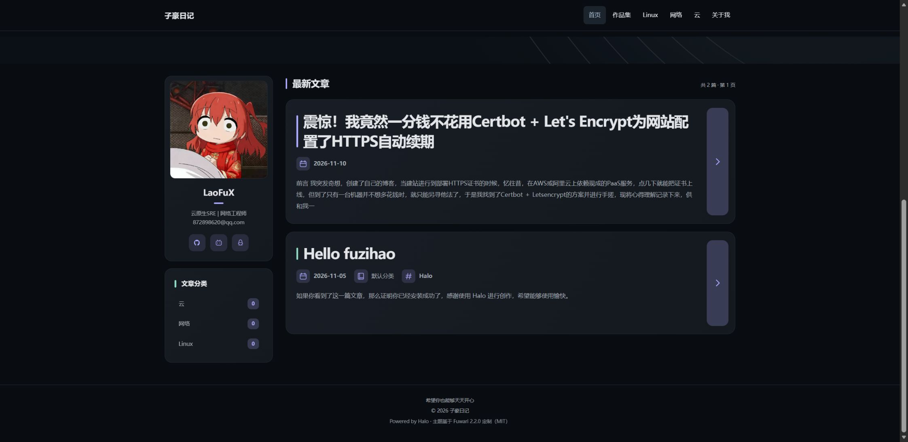

# 分类与代码框操作指南

## 文章分类与菜单

1. 进入 Halo“文章 → 分类”，创建或编辑真实分类的名称与别名。
2. 复制页面显示的分类固定链接。
3. 进入“外观 → 菜单”，修改对应菜单项的名称，并使用刚复制的真实链接。仅改菜单不会修改分类。
4. 在文章设置的“分类目录”中选择真实分类并保存，再刷新文章与对应分类归档确认。
5. 首页辅助栏从 Halo 分类数据实时生成，不另存一份名称；当前主题过滤 slug=default 或名称=默认分类 的项目。不要用 Halo 的“在列表中隐藏”代替，它还可能隐藏分类下的文章。

演示站这次将分类1、分类2、分类3分别改为 Linux（Linux）、网络（network）、云（cloud），以匹配现有菜单。此操作是站点数据维护，不随主题 ZIP 自动写入其他站点，也不会自动更改任何文章分类。

## 代码框

主题 1.2.9 为 Shiki 1.5.1 simple 样式提供圆角灰色卡片、语言标题、无行号和常显复制按钮；复制仍由 Shiki 实现，并保留成功图标。深浅色由主题 html[data-scheme] 同步。手机端长行在代码框内横向滚动。

ByteMD 中用三个反引号包围代码，并在开始的反引号后填写 bash、yaml、nginx、ini 等语言。未标语言的旧文章会显示“纯文本”，主题不会擅自改文章内容或猜测语言。Mermaid 图表不参与本次代码卡片适配。

修改入口是 public/assets/code-cards.js 与 refinement.css；构建生成模板，不手改 templates。无滚动监听、定时轮询、额外高亮库和复制按钮之外的新交互。

升级 Shiki 后需检查 simple 组件 Shadow DOM 结构；其他 variant 不承诺同样布局。无插件时保留原生 pre 灰色卡片，插件功能需要插件本身提供。

## 上线实拍

