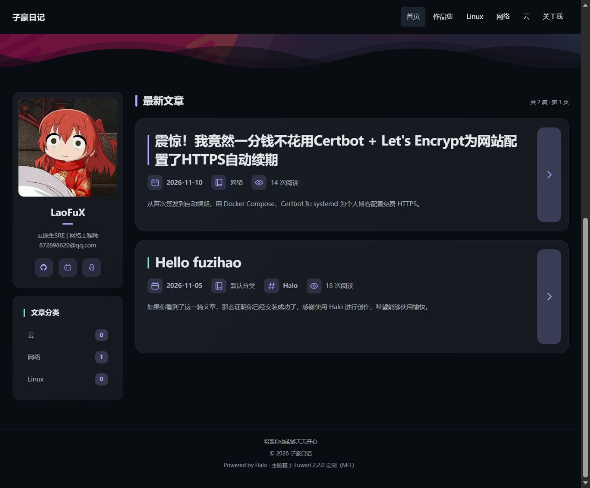
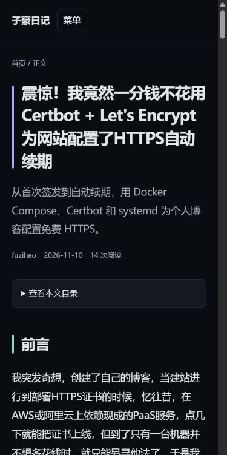

# 副标题与阅读量（1.3.0）

## 为每篇文章填写副标题

1. 打开 Halo 后台 → 文章，进入需要修改的文章。
2. 点击右上角“设置”。
3. 取消勾选“自动生成摘要”。
4. 在出现的“自定义摘要”中填写一句简短介绍，推荐 30～80 字。
5. 点击设置面板底部“保存”。刷新网站检查。

这是 Halo 原生文章字段，不需要插件，也不在主题全局设置中。现有手动摘要自动成为副标题；仍使用自动摘要的文章隐藏这行，避免正文再次被截取。需要隐藏时清空自定义摘要，或者重新勾选自动生成。纯文本渲染，HTML 不会执行；文章列表限制为两行，详情页允许换行。

副标题存储在 `post.spec.excerpt.raw`，只有 `autoGenerate=false` 且非空时展示。更改摘要也会影响 Halo 中其他读取文章摘要的插件或订阅输出，并非独立的主题专有字段。正文不会因编辑副标题而变化。

## 阅读量

卡片日期、分类旁展示“X 次阅读”，详情页作者、日期旁也展示。数据来自 Halo 的 `post.stats.visit`，不是点赞数、评论数或独立访客数。访问统计由 Halo 维护，缓存和计数入库可能有延迟；刷新后读取最新可用值。主题不主动增加计数、不模拟阅读、不轮询统计接口，打开列表不会由主题逐篇上报文章访问。

## 升级与回滚

后台 → 外观 → 主题 → 主题管理 → 上传安装 / 升级 → 选择 `theme-hao-diary-1.3.0.zip` → 确定升级。同主题 ID 保留现有配置；不要覆盖整站默认配置或重建容器。升级后刷新首页和文章页。

若回滚，上传已保留的 1.2.9 包。手动摘要属于文章数据，回滚主题不会清空它；旧主题仍会把摘要当作卡片介绍展示。生产升级前主题副本位于服务器 `/opt/halo-stack/backups/theme-before-1.3.0/`。

## 验收

隔离 Halo 2.27.2 验证了手动、自动、空副标题，HTML 转义，列表与详情阅读量。另检查生产桌面、390px 手机布局及正文代码框。实现仅新增模板和 CSS，无新增前端脚本。
